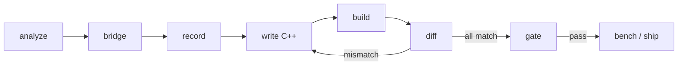

# How it works

cpp-anything is a loop and a contract. The loop moves one unit at a time; the
contract is the recorded cases.



## Units

A unit is one Python module: a `.py` file, or a package's `__init__.py`. It is small
enough to port in one sitting and to gate on its own. `bridge` refuses a unit whose
functions cannot be called as plain functions; the analyzer reports those as
skipped (decorated, `async`, `*args`/`**kwargs`).

## The wire format

One case per line, `cases.jsonl`:

```json
{"id":"truncate:3","fn":"truncate","args":["  Mixed CASE  ",7],"expect":{"ok":"  Mixed…"}}
{"id":"digits_only:1","fn":"digits_only","args":[" "],"expect":{"err":{"type":"ValueError","msg":"invalid literal for int() with base 10: ''"}}}
```

The C++ driver reads cases and writes one result per line:

```json
{"id":"truncate:3","result":{"ok":"  Mixed…"}}
{"id":"digits_only:1","result":{"err":{"type":"ValueError","msg":"invalid literal for int() with base 10: ' '"}}}
```

Values that JSON cannot express exactly are tagged, and both sides speak the same
tags:

| Python | JSON |
| --- | --- |
| `1` | `1` (integers stay integers) |
| `1.0` | `1.0` |
| `float("nan")` | `NaN`, `Infinity`, `-Infinity` |
| `(1, 2)` | `{"$tuple":[1,2]}` |
| `{1, 2}` (a set) | `{"$set":[1,2]}`, sorted for stability |
| `{1: "a"}` (non-string keys) | `{"$map":[[1,"a"]]}` |
| `b"hi"` | `{"$bytes":"aGk="}` |
| an object the analyzer cannot type | `{"$opaque":"repr(...)"}` |

Failures cross as `cppan::Result<T>` (`std::expected` on C++23 targets):
`PortError{"ValueError", "..."}` becomes the same `err` shape the recorder wrote. A C++ exception escaping the port
is reported as `RuntimeError`, and anything else as `CppAbort`, so a crash is a
mismatch rather than a dead driver.

## Comparison rules

- **Errors compare by type.** `ValueError` is `ValueError`; the message is not part
  of the contract unless you ask (`--strict-errors`).
- **Integers and reals are different values.** Python's `1 == 1.0` is not a licence
  for a port to change a return type silently. `--tolerance` compares numbers
  relatively and allows int-real agreement.
- **Floats are bit-exact.** `-0.0` is not `0.0`. `--tolerance 1e-9` is the escape
  hatch for genuinely numeric code.
- **Arrays keep order; objects do not.** A Python dict becomes `std::map`, whose
  iteration order differs; comparing as maps is what the caller can observe.
- **Missing results are failures.** A case with no line in `results.jsonl` is
  reported, not ignored.

## What `record` generates

Per function, from the annotations: a corpus of edges for each parameter type —
empty and whitespace strings, unicode, long strings, digits, signs, `NaN`,
`Infinity`, `-0.0`, empty and populated lists and dicts, `None` for optionals — plus
a few seeded random arguments so the port is not tuned to the table. Unannotated
parameters get a mixed corpus and the analyzer adds a risk ("this crosses as
`cppan::Json`").

The corpus stays inside `int64`, deliberately: a value outside it cannot cross as
`std::int64_t`, so the analyzer reports "Python ints are unbounded" as a risk
instead of recording a case the generated signature can never satisfy.

## What `gate` checks

| Step | Fails when |
| --- | --- |
| matrix | the target toolchain has no `std::expected` for the chosen standard (checked before a compiler ever runs) |
| no stubs | any body still returns `CPPAN_STUB` |
| build | CMake or the compiler fails; the warning count is reported |
| dispatch | the driver's function list differs from the analyzed signatures |
| diff | any recorded case mismatches, or a case produced no result |
| bench (`--bench`) | the port is slower than the original |

## The generated project

```
cpp/textkit-words/
├── CMakeLists.txt              # C++23, warnings on, /Zc:__cplusplus on MSVC
├── include/cppan/json.hpp      # the JSON codec the driver needs (no dependencies)
├── include/cppan/wire.hpp      # decode/encode, PortError, Registry
├── include/cppan/profile.hpp   # CPPAN_HAS_* from the matrix, static_assert on the standard
├── include/textkit_words/port.hpp   # your signatures, real C++ types
├── src/port.cpp                # the only file you write
├── src/dispatch.cpp            # one lambda per function: arity, decode, call, encode
├── src/main.cpp                # driver: --cases, --out, --bench, --list
├── README.md                   # inventory, risks, rules
├── cases.jsonl                 # recorded behaviour
└── .cppan/{project.json,inventory.json}
```

`refresh` rewrites the generated files after a signature change and leaves
`src/port.cpp` alone. `bridge` refuses to write into a non-empty directory without
`--force`.

## Risks the analyzer reports

Heuristics over the source, printed in the plan and in the generated README:

- `len()`/slicing on `str`: Python counts code points, C++ counts bytes.
- `int()`/`float()`: Python accepts underscores, unicode digits, `inf`/`nan`.
- `.split()`/`.strip()` with no argument: unicode whitespace, not ASCII.
- unicode case mapping (`lower`/`upper`) versus ASCII `std::tolower`.
- `re`: lookaround, backreferences, `\w` and case-insensitivity differ.
- `sorted`/`list.sort`: stable in Python, `std::sort` is not.
- float formatting (`f"…"`, `format()`, `%`): Python's shortest repr.
- `**`, `//`, `/`: unbounded ints, floor division vs truncation, always-float division.
- `datetime`, `random`, file and network I/O.
- unannotated parameters and returns: the port crosses them as `cppan::Json`.

Each risk names the file:line in the plan; none of them is a failure by itself.

## What it can't catch

- Branches no generated input reaches. Add real inputs with `record --inputs cases.jsonl`.
- Differences the recording cannot see: performance, memory, thread safety, logging,
  files written outside the process, network calls, database state.
- Message-level error contracts (use `--strict-errors`), and float formats where
  `--tolerance` is too loose or too tight.
- Anything outside the unit: callers, import side effects, module-level state
  captured at import time.
- Unicode semantics the corpus does not include: unicode digits in `int()`,
  combining marks in slicing, grapheme clusters (Python itself counts code points,
  so a port matching code points matches Python).

`gate` passing means "behaves like the original on what was recorded, and the
toolchain can express it". That is the strongest claim a recording can make.

## RSI: verifying the tool itself

`cpp-anything rsi check` runs four checks in the checkout:

1. **matrix data** — the embedded matrix parses, has ≥ 600 features, and every
   source page carries a cppreference revision id.
2. **guides** — `docs/guides/**` is byte-identical to what `matrix docs` renders.
3. **cli goldens** — nine deterministic commands print what `rsi record` stored
   (`tests/golden/cli.jsonl`), after normalising dates and paths.
4. **self port** — the shipped example (`examples/textkit-cpp`) is regenerated into
   a temp directory, built, and its 105 recorded cases must all match.

Step 4 is the point: the generator, the wire format, the driver and the comparison
are exercised on every change by the same machinery that gates a user's port.

## Design notes

- No third-party crates. JSON, the type model, argv handling and hashing are a few
  hundred lines the tool owns and unit-tests; the binary runs on a bare machine.
- The matrix is embedded at compile time, so `matrix` answers identically offline;
  sync and guide rendering are separate, explicit steps.
- Generated C++ is written for C++20/23 and gated by the matrix rather than by
  `__has_include` guesses: if the profile says the toolchain has no `std::print`,
  the port does not get to use it.
