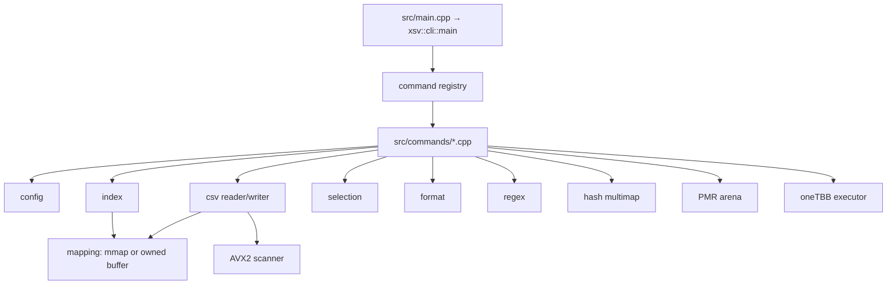

# Architecture

## 1. Shape



One static library (`xsv_core`) and one executable per build variant. There is
no plugin system and no runtime dependency selection: the ablation axes are
compile-time, so `xsv --version` names the exact binary.

## 2. Directory contract

| path | owns |
| --- | --- |
| `include/xsv/*.hpp` | public interfaces; no command logic |
| `src/csv.cpp` | record scanner and RFC 4180 writer |
| `src/index.cpp` | frozen `xsv` index format |
| `src/select.cpp` | column selection grammar |
| `src/mmap.cpp` | file mapping / full read fallback |
| `src/memory.cpp` | PMR arena and allocation counters |
| `src/hash.cpp` | 64-bit string hash |
| `src/simd.cpp` | scalar + AVX2 byte scanners, runtime dispatch |
| `src/parallel.cpp` | thread configuration and TBB global limit |
| `src/format.cpp` | Rust-compatible integer/float formatting and parsing |
| `src/regex.cpp` | RE2 wrapper |
| `src/cli.cpp` | argument loop, help, exit codes |
| `src/commands/` | one translation unit per command |
| `tests/` | CTest unit + CLI smoke tests |
| `scripts/` | data, replay, measurement, reporting |
| `evaluation/` | case corpus and benchmark matrix |
| `docs/` | this contract |

## 3. Ownership and lifetimes

- **Input bytes** are owned by `Mapping` and live for the whole command.
- **Records** are `std::vector<std::string_view>` into those bytes. Unquoted
  fields are zero-copy; quoted fields are unescaped into a per-reader scratch
  buffer that stays valid until the next `next()` call. (A clean quoted field
  could also be zero-copy; the current implementation trades that micro-
  optimization for one simple, testable path.)
- **Selections** own only the column indices.
- **Join keys** are views into the two mappings, so the hash table stores
  `string_view` and never copies a key. Values are row ordinals (`uint32_t`).
- **Sort** owns extracted byte keys or a permutation, depending on the
  implementation variant; the CSV bytes stay in the mapping.
- **Errors** are values (`xsv::Error`), never exceptions. No exception crosses a
  command boundary.

## 4. CSV reader

`csv::Reader` is a pull parser over `std::span<const char>`:

1. Optional UTF-8 BOM is skipped before the first record.
2. Empty lines are skipped, including CRLF and lone CR (`\r`, `\n`, `\r\n`).
3. A field is quoted only when its first byte is the quote byte (default `"`).
4. Inside quotes: `""` is an escaped quote when `double_quote` is on; an escape
   byte escapes the next byte when configured; CR/LF are content and update the
   line counter.
5. Bytes after a closing quote and before a delimiter are appended to the field
   (the reference parser is lenient here; differential tests pin the exact
   behaviour).
6. `Record::byte_offset` is the reference's record position, which is exactly
   what the index stores. It is the scan position after the previous record's
   terminator and before blank lines are skipped. For a CRLF file this is the
   LF of the previous pair, not the first field; seeking there still works
   because the reader skips the LF. `Record::line` is the 1-based line at record
   start.
7. When `flexible` is off, every record must have the header's field count (or
   the first record's count with `--no-headers`). The error text is:
   `CSV error: record N (line: L, byte: B): found record with X fields, but the
   previous record has Y fields`, where N counts data records from 1. This was
   verified against `xsv 0.13.0`.

The scanner has a scalar path and an AVX2 path (`simd::find_record_special`).
The AVX2 function is compiled with a target attribute and selected once via
`__builtin_cpu_supports`, so the portable binary still uses SIMD on capable
hosts. `XSV_WITH_SIMD=OFF` removes the dispatch entirely.

Deliberate allocation rule: parsing a record appends to one scratch buffer only
when the record contains at least one quoted field; the buffer is reserved once
per record. Unquoted fields never allocate.

Sequential commands (`count`, `select`, `search`, `slice`, `stats`) call
`madvise(MADV_DONTNEED)` on already-consumed mapped pages every 8 MiB. This keeps
peak RSS proportional to the window instead of the file size. The pages remain
in the kernel page cache, so a second run still benefits from warm cache.

## 5. Writer

`csv::Writer` writes the shortest legal representation:

- quote when the field contains the delimiter, quote, CR, LF, or the escape
  byte (when `double_quote` is off);
- a single empty field is written as `""` to distinguish it from a blank line;
- terminator defaults to `\n`; `\r\n` is a writer option used by `fmt`;
- one `write` syscall per record into an `std::ostream`; commands wrap stdout in
  a large buffer.

## 6. Index

Frozen layout, byte-for-byte identical to `csv-index 0.1.5`:

```
u64be offset(record 0)   // header included when has_headers
u64be offset(record 1)
...
u64be offset(record N-1)
u64be N                  // total records written above
```

- `Index::open` maps the file read-only, reads the last 8 bytes, validates
  `N <= size/8 - 1`.
- `Index::offset(i)` is an O(1) read; no full-file load.
- `count` uses the index only when `<input>.idx` exists and the CSV's mtime in
  seconds is not newer than the index's. A newer CSV is an error, matching the
  reference text.
- `create_index` writes offsets through an `std::ostream` (buffered file), so
  indexing 100 M rows does not hold the index in memory.

## 7. Selection

`Selection::parse(spec, headers, use_names)` implements the reference grammar:

```
selection := ["!"] selector ("," selector)*
selector  := one ["-" one]
one       := index | name | name "[" usize "]" | start | end
start     := ""   (leading '-')
end       := ""   (trailing '-')
```

- indices are 1-based; `Name[k]` is the k-th occurrence, 0-based;
- descending ranges are inclusive and exclude the start, exactly like the
  reference (`4-2` → 4,3,2);
- `!` inverts the union of selected indices;
- quoted names use `"..."`; `""` is copied literally as two quote bytes, which
  is a reference quirk kept for parity;
- names are rejected with `--no-headers`.

## 8. Memory

`memory::Arena` exposes a `std::pmr::memory_resource*`:

- `XSV_WITH_PMR=ON`: a `monotonic_buffer_resource` over a 64 KiB stack buffer,
  upstreamed to a counting `new_delete_resource`;
- `XSV_WITH_PMR=OFF`: the counting resource directly.

`live_bytes()` counts *upstream* live bytes; allocations served from the initial
buffer are intentionally invisible until the buffer is exhausted. `peak_bytes()`
is the high-water mark. `reset()` releases the monotonic chain in one operation.

Commands scope one arena per pipeline stage (parse keys, build hash, sort
permutation), so a stage's memory is returned before the next starts.

## 9. Hash table

`hash::FlatHashMultiMap<V>`:

- power-of-two slot array of `uint32_t` entry indices (0 = empty);
- entries: `{hash, string_view key, V value, next_same, tail}`;
- open addressing with linear probing and load factor 0.7;
- duplicate keys form an insertion-ordered chain; `for_each_match` yields values
  in insertion order, matching the reference's `HashMap<key, Vec<row>>` join
  output order;
- no deletion (build once, probe many);
- `StdHashMultiMap<V>` is the control: `unordered_map<string, vector<V>>`.

The string hash is deterministic (splitmix finalizer over 8-byte lanes), so
iteration order is stable for a fixed input and across runs.

## 10. Parallelism

`parallel::for_each_index(count, grain, fn)`:

- with `XSV_WITH_TBB=ON`, `tbb::parallel_for` over `blocked_range`;
- otherwise a serial loop;
- `XSV_THREADS` sets the worker limit; `0`/unset means hardware concurrency;
- a `tbb::global_control` applies the limit process-wide.

Determinism rules for commands:

- parallel stats processes fixed chunks and merges them in chunk order; each
  worker advises away consumed mapped pages every 8 MiB, which keeps the
  100M-row run at 186 MB RSS instead of 25.4 GB;
- hash join builds a flat table from the build side and probes in input order;
  the port keeps this join serial, so output order is input order;
- parallel sort sorts fixed chunks and performs a stable k-way merge, so equal
  keys keep input order;
- floating-point reductions use the reference's online algorithm per chunk and
  the same merge formula; the tolerance contract is documented in
  COMPATIBILITY.md and tested.

## 11. Regex

`Regex::compile(pattern, ignore_case)` wraps RE2 with UTF-8 encoding. RE2 is
chosen because the Rust regex crate is also linear-time and rejects
backreferences/lookaround. Known syntax differences and the differential policy
are in COMPATIBILITY.md.

## 12. Formatting

`stats` writes numbers that must match Rust's `Display`:

- integers: `std::to_chars`;
- floats: shortest round-trip digits from `std::to_chars(general)`, then expand
  any exponent into plain decimal notation (`1e+20` → `100000000000000000000`,
  `1e-7` → `0.0000001`), with `inf`/`-inf`/`NaN` spellings;
- parsing accepts Rust's grammar: optional `+`/`-`, `1.`, `.5`, `inf`,
  `infinity`, `NaN` (case-insensitive), and rejects whitespace/trailing bytes.

## 13. CLI

- `xsv <command> [args]`; no command prints the usage to stderr and exits 0,
  matching the reference.
- `--version` prints the C++ version, the compatible upstream version and the
  variant name; differential replay excludes version text.
- exit codes: 0 success, 1 runtime/usage error.
- SIGPIPE is ignored; a closed stdout becomes a write error with exit 1 (the
  reference's `println!` panics; this is a documented deviation, tested
  separately from semantic stdout).
- help text for each command is copied from the reference and compared
  byte-for-byte.

## 14. Build axes

| macro | OFF | ON |
| --- | --- | --- |
| `XSV_USE_PMR` | per-allocation upstream | monotonic arenas |
| `XSV_USE_SIMD` | scalar scan | AVX2 dispatch |
| `XSV_USE_TBB` | serial loops | oneTBB |
| `XSV_USE_CUSTOM_HASH` | `unordered_map<string, vector>` | flat open addressing |
| `XSV_USE_MMAP` | read entire file | `mmap` |
| `XSV_USE_RE2` | regex command absent | RE2 |

The reference optimized binary is `all`; the language-level control is `base`.

## 15. P0 command notes

- `headers` reproduces tabwriter's cell-block width algorithm, including tabs
  and newlines inside header names; `-j` bypasses the tabwriter and writes raw
  names, exactly like the reference.
- `select` and `search` use the same first-record rule as the reference: with
  `--no-headers`, the first row is both the selection header and a data row.
  The CSV writer represents a zero-field projection as `""`, not a blank line.
- `slice` validates and opens the index before writing the header, so a stale
  index produces no stdout; it seeks with the frozen index and streams the rest.
- `sort` stores rows in one packed byte buffer plus offset arrays, then stable
  sorts a permutation. `-R` swaps comparator operands, not the output vector.
- `stats` streams and accumulates per column. With an index and `-j > 1`, fixed
  row chunks are computed in oneTBB and merged in chunk order; `-j 1` is
  serial. The mode and median
  paths reproduce the reference's run-based mode algorithm and `Unsorted`
  median, including their non-obvious tie behaviour.
- `join` stores the build side, indexes it with `hash::MultiMap`, and streams the
  probe side. All five modes share one normalized composite key; right joins
  swap roles, not output column order.
- `sort` uses a parallel stable chunk sort plus pairwise stable merge under
  oneTBB; equal keys keep input order. `XSV_THREADS=1` falls back to
  `std::stable_sort`.
- `RecordStore` (sort, join build/probe sides) uses PMR vectors when
  `XSV_WITH_PMR=ON`; the arena is owned by the store, so its lifetime covers
  all rows.
