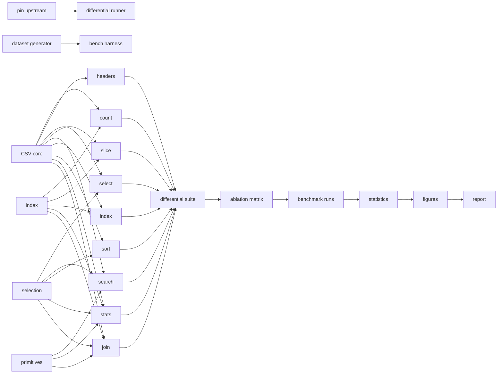

# xsv-cpp Benchmark v1.0 — development plan

Status: **M0–M5 complete on the standard profile. All nine P0 commands pass the 144-case gate on eight builds; optimization integration and the formal report are done. M6 archive checksums are written. A 100M-row D4 subset (count/index/select/search/stats/slice) and a TSC/getrusage CPU-indicator run are complete; 100M sort/join remain infeasible on the 30 GB host.**
This file is the task contract. Every task has an output and an acceptance check;
a task is done only when the check runs green in the repository.

## 0. Baseline (fixed, do not float)

| item | value |
| --- | --- |
| upstream | [BurntSushi/xsv](https://github.com/BurntSushi/xsv) |
| release | `0.13.0` (annotated tag) |
| commit | `2b4cbaa0eecf7b507a612632fe00289b1b358c15` |
| tag date | 2018-05-12 |
| repository state | archived 2025-04; read-only |
| license | Unlicense / MIT (both texts in `licenses/`) |
| reference compiler | Rust 1.99.1, `cargo build --release` |
| ref. binary | `upstream/xsv/target/release/xsv`, SHA-256 recorded by `scripts/fetch_upstream.sh` |

The reference build is not "whatever cargo resolves today": `upstream/PIN.txt`
records the tag, commit, `Cargo.lock` SHA-256, toolchain version and binary
SHA-256. A benchmark run is invalid if the PIN does not match.

## 1. Scope

**In scope: the nine P0 commands.**

| # | command | module | state |
| --- | --- | --- | --- |
| C1 | `count` | `src/commands/count.cpp` | **implemented** |
| C2 | `headers` | `src/commands/headers.cpp` | **implemented** |
| C3 | `select` | `src/commands/select.cpp` | **implemented** |
| C4 | `slice` | `src/commands/slice.cpp` | **implemented** |
| C5 | `search` | `src/commands/search.cpp` | **implemented** |
| C6 | `index` | `src/commands/index.cpp` | **implemented** |
| C7 | `sort` | `src/commands/sort.cpp` | **implemented** |
| C8 | `stats` | `src/commands/stats.cpp` | **implemented** |
| C9 | `join` | `src/commands/join.cpp` | **implemented** |

P0 differential replay is green. P1/P2 commands remain out of scope for v1.0.

## 2. Fixed experiment configuration

| axis | value | build switch |
| --- | --- | --- |
| compiler | GCC only, tested 15.2.0 | configure-time `FATAL_ERROR` on non-GNU |
| standard | C++23 | `CMAKE_CXX_STANDARD=23` |
| build | CMake + Ninja | presets in `CMakePresets.json` |
| optimization | `-O3 -DNDEBUG`, LTO on | `XSV_LTO` |
| CPU target | portable by default; `-march=native` only in the `native` preset | `XSV_NATIVE` |
| memory | `std::pmr` arenas | `XSV_WITH_PMR` |
| SIMD | AVX2, runtime dispatched, scalar fallback | `XSV_WITH_SIMD` |
| parallelism | oneTBB | `XSV_WITH_TBB` |
| hash | custom open addressing | `XSV_WITH_CUSTOM_HASH` |
| I/O | `mmap` zero-copy input | `XSV_WITH_MMAP` |
| regex | RE2 | `XSV_WITH_RE2` |

`base` means every `XSV_WITH_*` switch is OFF; `all` means every switch is ON.
The two are the language-level comparison; the single-axis builds are the
ablation, not extra language comparisons.

## 3. Work breakdown

Estimates are person-days for one experienced C++ engineer. “Done” is a
repository state, not a conversation.

### Phase A — foundation (M0)

| ID | task | depends | output | acceptance | est. |
| --- | --- | --- | --- | --- | --- |
| A1 | Pin upstream and build the Rust reference | — | `scripts/fetch_upstream.sh`, `upstream/PIN.txt` | binary prints `0.13.0`; PIN has tag/commit/lock SHA/binary SHA | 0.5 |
| A2 | Environment capture | — | `scripts/collect_env.py` | JSON contains CPU model/flags, kernel, all compilers, binary SHA, dataset SHA | 0.5 |
| A3 | Dataset generator | — | `scripts/generate_datasets.py`, `datasets/manifests/*.json` | smoke profile is deterministic twice: identical SHA-256 | 1.5 |
| A4 | Differential runner | A1 | `scripts/run_correctness.py`, `evaluation/correctness/cases.jsonl` | replay of `count` fixtures reports 0 mismatches | 1.0 |
| A5 | Benchmark + report harness | A3 | `scripts/run_benchmarks.py`, `scripts/generate_report.py` | smoke run produces raw JSONL, processed CSV, Markdown and SVG | 1.5 |
| A6 | CMake, variants, sanitizers | — | `CMakeLists.txt`, `cmake/*`, `CMakePresets.json` | preset list validates; every axis macro exercised in both states; `base`/`all`/`asan`/`tsan` build and test green | 1.5 |
| A7 | CSV reader/writer | — | `src/csv.cpp`, `tests/test_csv.cpp` | unit tests green; byte offsets, quoting, CRLF, BOM, ragged errors | 2.0 |
| A8 | Selection language | — | `src/select.cpp` | grammar tests match `xsv select` on ranges, inversion, names | 1.0 |
| A9 | Index read/write | — | `src/index.cpp` | byte-level test of the frozen `N+1` big-endian format | 0.5 |
| A10 | Primitives: PMR, flat hash, AVX2 scan, TBB wrapper, RE2 wrapper, Rust-compatible formatting | — | `src/{memory,hash,simd,parallel,format,regex}.cpp` | unit tests green; format matches Rust `Display` corpus | 2.0 |

### Phase B — P0 commands (M1–M2)

Every command task must ship: implementation, unit tests for its pure parts,
differential cases, help text copied from the reference, and index fast path
where the reference has one.

| ID | task | depends | output | acceptance | est. |
| --- | --- | --- | --- | --- | --- |
| C1 | `count` | A7, A9 | `src/commands/count.cpp` | differential equals reference on files/stdin/index/errors | **done** |
| C2 | `headers` | A7 | command + tabwriter emulation | `headers`, `-j`, `--intersect`, multiple inputs byte-identical | **done** |
| C3 | `select` | A7, A8 | command | all selector forms, duplicate names, `--no-headers`, output writer parity | **done** |
| C4 | `slice` | A7, A9 | command | `-s/-e/-l/-i`, no-index and indexed paths, range errors | **done** |
| C5 | `search` | A7, A8, A10 | command | RE2 subset parity matrix; `-i`, `-v`, `-s`, stdin | **done** |
| C6 | `index` | A7, A9 | command | `.idx` byte-identical to reference for the corpus | **done** |
| C7 | `sort` | A7, A8 | command | stable order; lexical/numeric/reverse; NaN and mixed numeric rules | **done** |
| C8 | `stats` | A7, A8, A9 | command | default columns; `--everything/--mode/--median/--cardinality/--nulls`; `-j`; indexed merge | **done** |
| C9 | `join` | A7, A8, A9, A10 | command | inner/left/right/full/cross; `--no-case`, `--nulls`; duplicate and skewed keys | **done** |
| C10 | CLI parity | C1–C9 | help/version/list/error paths | help text and exit codes byte/class-identical; broken-pipe policy documented | **done** |
| C11 | Differential suite for all P0 | C1–C10 | `evaluation/correctness/cases.jsonl` | 144/144 cases pass on `base` and `all` | **done** |
| C12 | P0 gate | C11 | `scripts/run_correctness.py --gate p0` | required case families all present and green | **done** |

**P0 exit criteria**

- all nine commands implemented, no stubs, no “not implemented” branch;
- 100% differential pass on both `base` and `all`;
- ASan/UBSan clean on the differential corpus; TSan clean on `stats -j` and `join`;
- `.idx` produced by C++ is accepted by the Rust reference and vice versa;
- help text for each command is byte-identical to the reference.

### Phase C — optimization and ablation (M3)

| ID | task | depends | output | acceptance | est. |
| --- | --- | --- | --- | --- | --- |
| O1 | PMR arenas in sort/join/stats | C7–C9 | arena-scoped row/key storage | `RecordStore` uses PMR vectors; memory delta measured; ASan clean | **done** |
| O2 | Custom flat hash in join/stats | C8, C9 | `hash::MultiMap` selected by build | join uses flat hash; differential green; ablation measured | **done (join)** |
| O3 | mmap / zero-copy input | C1–C9 | `Mapping` used by every reader | optimized path maps; RSS difference measured | **done** |
| O4 | AVX2 record scanner | A7 | dispatch used in parser hot path | unquoted field scan uses AVX2; gate/unit tests bit-identical | **done** |
| O5 | oneTBB parallel paths | C8, C9 | parallel stats chunks, stable merge sort | deterministic output; scaling measured 1–32 threads | **done (stats/sort)** |
| O6 | Ablation build matrix | O1–O5 | 15 presets in `CMakePresets.json` | base, all and six single-axis builds pass the gate; formal ablation runs | **done** |
| O7 | Edge-case audit per variant | O6 | report of differences | 144/144 on base/all/pmr/simd/tbb/hash/mmap/pst | **done** |

### Phase D — measurement (M4)

| ID | task | depends | output | acceptance | est. |
| --- | --- | --- | --- | --- | --- |
| M1 | Materialize D1–D3 (+D4 opt-in) | A3 | `datasets/data`, manifests | SHA-256 in manifest matches file; manifest committed | 1.0 |
| M2 | B01–B12 runs | A5, M1 | `results/raw/*.jsonl` | 3 warmups + 20 measured runs, randomized interleaving | 3.0 |
| M3 | Peak RSS and allocation profiles | M2 | `results/raw/memory.jsonl` | RSS via `/usr/bin/time -v`; heaptrack artifacts for sort/join | 1.0 |
| M4 | Thread scaling | O5 | `results/raw/scaling.jsonl` | 1,2,4,8,16,32 threads; throughput per count | 1.0 |
| M5 | CPU counters and flamegraphs | M2 | `results/raw/perf.jsonl`, `results/figures/flame/*.svg` | `perf stat` IPC/cycles/instructions; `perf record` hotspots | 1.5 |
| M6 | Statistics | M2 | `scripts/generate_report.py` | median/P95/stddev; bootstrap 95% CI; paired Wilcoxon or Mann–Whitney | 1.5 |

### Phase E — report (M5–M6)

| ID | task | depends | output | acceptance | est. |
| --- | --- | --- | --- | --- | --- |
| R1 | Figures 1–5 | M6 | `results/figures/*.svg` | generated from raw JSONL, no hand-entered numbers | 2.0 |
| R2 | Report sections 1–11 | R1 | `report/report.md` (+ PDF) | every claim traceable to a raw file | 3.0 |
| R3 | Reproduction package | R2 | `scripts/reproduce.sh` | clean machine: fetch, build, test, measure, report | 1.0 |
| R4 | License and attribution audit | — | `ATTRIBUTION.md`, `licenses/` | upstream texts present; no upstream source copied | 0.5 |
| R5 | Threats-to-validity chapter | R2 | report section 10 | language vs algorithm vs allocator effects separated | 1.0 |

**Total estimate:** ~60 person-days. That is six calendar weeks with two
engineers working in parallel (foundation/commands and measurement/report), or
about twelve weeks for one engineer. The plan does not pretend the six-week
schedule is a one-person schedule.

## 4. Milestones

| milestone | exit condition |
| --- | --- |
| **M0** baseline | reference binary pinned; generator, differential and benchmark harness run; `base`/`all` build; core unit tests green |
| **M1** tracer | `count` byte-identical to the reference; index fast path works; one end-to-end differential case family green |
| **M2** P0 | ✅ nine commands; 144/144 differential on `base` and `all`; 14/14 CTest; ASan/TSan green |
| **M3** optimized | ✅ all five axes integrated; 8-variant gate green; per-axis correctness green |
| **M4** measured | ✅ B01–B07/B10 on standard profile; memory, scaling, ablation; perf counters blocked by kernel permission |
| **M4b** D4 subset | ✅ 100M-row count/index/select/search/stats/slice at n=3; base omitted (38 GB whole-file read); stats parallel RSS fixed to 186 MB |
| **M5** reported | ✅ figures 1–5 and paper-style report generated from raw data |
| **M6** archived | artifact archive (source, results, manifests, env) with SHA-256 index |

## 5. Dependency graph (critical path)

## 6. Definition of done (P0)

1. `cmake --preset all && cmake --build --preset all && ctest --preset all`
   green.
2. `scripts/run_correctness.py --gate p0` green for `base` and `all`.
3. ASan/UBSan build green; TSan build green on the concurrent cases.
4. `scripts/run_benchmarks.py --profile smoke` produces a complete raw file;
   `scripts/generate_report.py` consumes it.
5. Every command has: implementation, tests, differential cases, help text,
   and a COMPATIBILITY.md entry.
6. No TODO/FIXME in `src/`; no placeholder command returns success.

## 7. Risk register

| risk | impact | mitigation |
| --- | --- | --- |
| RE2 + Abseil build cost and API drift | CI time, reproducibility | pinned commits; system-package fast path; `XSV_FETCH_DEPS=OFF` offline audit |
| Rust regex vs RE2 syntax gaps | `search` parity failures | explicit supported-syntax matrix; differential error-class policy; document exclusions |
| Rust f64 `Display` vs `to_chars` | `stats` mismatches | own expand-exponent formatter; 100k-value randomized corpus against Rust |
| `sort` stability | output order mismatches | `std::stable_sort`; parallel merge preserves left-before-right |
| page cache accelerates the first process | false speedups | randomized interleaving; warmup; optional `posix_fadvise(DONTNEED)`; report cache state |
| TBB scheduling changes float reduction order | `stats` drift | fixed chunk boundaries; merge in deterministic order; tolerance contract |
| index mtime granularity | false “stale index” | match reference’s second granularity; explicit staleness test |
| old upstream crates break on new rustc | reference cannot build | PIN records successful toolchain; fallback toolchain in CI image |
| allocator noise | misleading memory deltas | same libc allocator; heaptrack; report both RSS and allocation counts |
| CI hardware heterogeneity | noisy numbers | formal runs only on fixed runner; CI runs smoke only |

## 8. Explicit non-goals for v1.0

- P1/P2 commands, MCP server, web UI.
- Portability to Clang/MSVC; the experiment fixes GCC.
- Matching clap/docopt error prose byte-for-byte; error *class* and exit code
  are the contract (stdout remains byte-exact).
- Beating the Rust reference. The report answers “where, why, and at what cost”,
  including the possibility that C++ loses.
