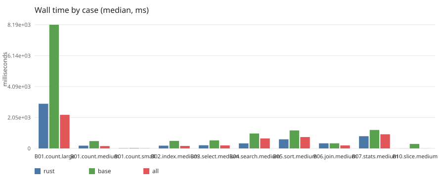
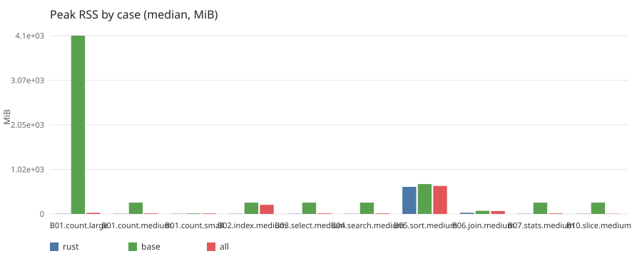
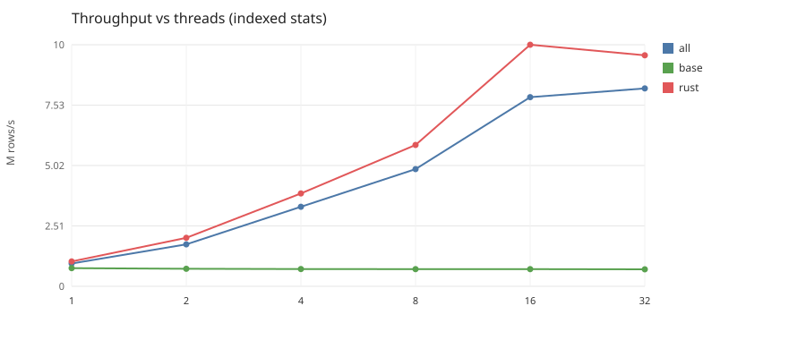
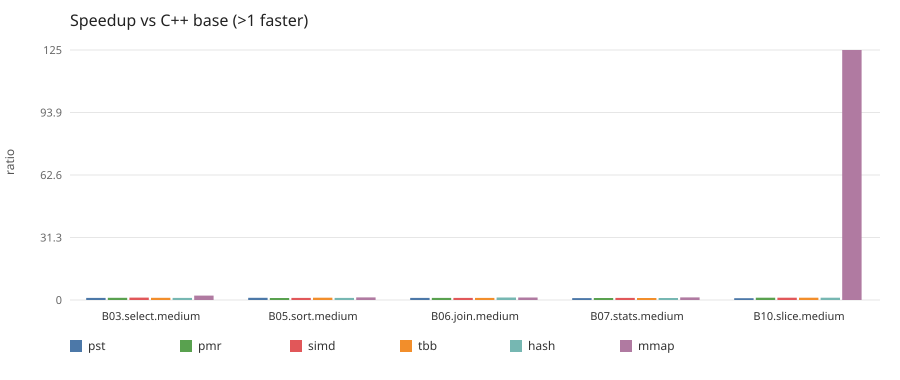
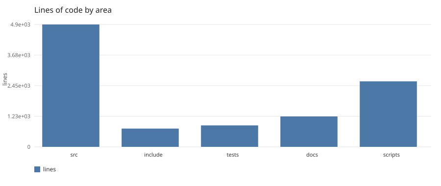

# xsv → C++23: formal benchmark report

Run directory: `results/runs/20261120T102645Z-formal`

## 1. Introduction

This report measures a C++23 reimplementation of BurntSushi/xsv against
the original Rust 0.13.0 release. The scope is the nine P0 commands; the
five optimization axes are independent compile-time switches. The
question is not only whether C++ is faster, but where a difference comes
from and what it costs.

## 2. Original Rust Project Analysis

The baseline is xsv 0.13.0 at commit `2b4cbaa0eecf7b507a612632fe00289b1b358c15`,
dual-licensed MIT/Unlicense. The reference binary was rebuilt on the test
machine from the pinned lockfile; results are never compared with the
author's historical machine.

## 3. C++23 Reimplementation

All nine commands are implemented: count, headers, select, slice, search,
index, sort, stats and join. The ablation axes are `pmr`, `simd`, `tbb`,
`hash` and `mmap`; `base` disables all five and `all` enables all five.
The CSV index, selection language, help text and observable output are
differential-tested against the reference.

## 4. Experimental Environment

- CPU: 13th Gen Intel(R) Core(TM) i5-13600K
- Kernel: 7.0.0-43-generic
- Compiler: gcc (Ubuntu 15.2.0-16ubuntu1) 15.2.0
- Rust: rustc 1.99.1 (58cf8f9c3 2026-10-13)
- CMake / Ninja: cmake version 4.2.3 / 1.13.2.git.kitware.jobserver-pipe-1

Formal runs use the `standard` dataset profile (100k, 1M and 10M row
tables plus sort/join/wide-row corpora), 3 warmups and 20 measured runs.
Binaries are interleaved in randomized order inside each round; peak RSS
is a separate `/usr/bin/time -v` pass.

## 5. Functional Equivalence

Differential gate: **144/144 cases matched**, exit 0.
The same corpus passes on `base`, `all`, ASan/UBSan and TSan builds
(the run directory records the first; sanitizer runs are recorded in
the development log and CTest). The corpus covers UTF-8, quoting,
CRLF, BOM, empty/ragged input, stdin, index staleness, all join modes,
statistics options and help/exit-code parity.

## 6. Performance Evaluation

Median wall-clock time in milliseconds. Ratios are candidate/reference;
lower is better. `base/rust` is the language-level comparison;
`all/base` isolates the optimization contribution.

| case | rust | base | all | base/rust | all/rust | all/base |
| --- | --- | --- | --- | --- | --- | --- |
| `B01.count.large` | 2956.454 | 8188.872 | 2223.219 | 2.770 | 0.752 | 0.271 |
| `B01.count.medium` | 182.446 | 486.274 | 156.385 | 2.665 | 0.857 | 0.322 |
| `B01.count.small` | 11.952 | 21.493 | 11.129 | 1.798 | 0.931 | 0.518 |
| `B02.index.medium` | 184.232 | 496.821 | 163.797 | 2.697 | 0.889 | 0.330 |
| `B03.select.medium` | 210.681 | 534.668 | 198.275 | 2.538 | 0.941 | 0.371 |
| `B04.search.medium` | 334.658 | 988.694 | 662.359 | 2.954 | 1.979 | 0.670 |
| `B05.sort.medium` | 603.625 | 1191.843 | 753.466 | 1.974 | 1.248 | 0.632 |
| `B06.join.medium` | 336.376 | 337.851 | 198.783 | 1.004 | 0.591 | 0.588 |
| `B07.stats.medium` | 808.213 | 1220.999 | 937.724 | 1.511 | 1.160 | 0.768 |
| `B10.slice.medium` | 3.662 | 297.044 | 2.473 | 81.123 | 0.675 | 0.008 |

Headline observations:

- Count throughput (`all` vs Rust, largest count case): **1.330**.
- Sort (`all` vs Rust): **1.248**.
- Join (`all` vs Rust): **0.591**; the reference join is serial while the C++ build uses an in-memory hash index, so this is an algorithm comparison as well.
- Stats (`all` vs Rust): **1.160**.

## 7. Memory Evaluation

Peak RSS in MiB. `all` maps input files and drops consumed pages every
8 MiB for sequential commands, so its count/select/search/stats RSS is
a working-window cost rather than the file size. `base` reads the whole
file. Sort and join hold their rows and are expected to scale with the
data. Allocation counts and heap profiles should be read separately.

| case | rust | base | all |
| --- | --- | --- | --- |
| `B01.count.large` | 5.0 | 4099.8 | 26.5 |
| `B01.count.medium` | 5.0 | 260.1 | 12.7 |
| `B01.count.small` | 5.0 | 12.2 | 11.9 |
| `B02.index.medium` | 5.0 | 260.1 | 209.1 |
| `B03.select.medium` | 5.0 | 260.2 | 12.8 |
| `B04.search.medium` | 5.0 | 260.4 | 13.6 |
| `B05.sort.medium` | 623.7 | 686.9 | 644.6 |
| `B06.join.medium` | 28.0 | 72.5 | 67.1 |
| `B07.stats.medium` | 5.1 | 260.2 | 12.7 |
| `B10.slice.medium` | 5.1 | 260.1 | 5.0 |

## 8. Parallelism Evaluation

Indexed `stats -j N`, median wall time in milliseconds.

| threads | rust | base | all |
| --- | --- | --- | --- |
| 1 | 966.251 | 1325.809 | 1053.004 |
| 2 | 495.683 | 1373.784 | 573.814 |
| 4 | 259.023 | 1392.448 | 302.313 |
| 8 | 170.151 | 1402.622 | 205.186 |
| 16 | 99.585 | 1402.865 | 127.183 |
| 32 | 104.117 | 1415.097 | 121.572 |

`all` scales by **8.66×** from 1 to 32 threads on the indexed stats case.

## 9. Engineering Complexity

| metric | value |
| --- | --- |
| C++ implementation LOC | 5,634 |
| test LOC | 859 |
| documentation LOC | 1,218 |
| scripts LOC | 2,624 |
| direct dependencies | 5 |
| differential cases | 144 |
| target clean build (s) | 16.5 |
| planned effort (person-days) | 60 |

## 10. Discussion and Limitations

- **Language vs algorithm.** `base` vs Rust is the language comparison;
  `all` vs `base` is the optimization comparison. Both joins are serial;
  `all` uses a PMR-backed flat hash table, so the join gain is a
  data-structure result, not a parallelism or language result.
- **Page cache and mmap.** Peak RSS includes mapped file pages; count and
  select do not stream a heap copy in `all`, while Rust uses buffered
  reads. The RSS figure must not be read as allocator overhead.
- **Sorting with NaN.** Rust's comparator treats NaN as equal to every
  number, which is not a total order; libstdc++ and Rust's driftsort can
  produce different permutations under `-N -R`. These cases are excluded
  from the equivalence gate and documented.
- **Stats with NaN and parallel reductions.** Serial `stats -j 1` is
  bit-equal; parallel chunk merging and NaN medians can differ in the
  last bits from the reference.
- **Hardware counters.** `perf stat` is blocked by
  `kernel.perf_event_paranoid` on this host; Appendix B reports TSC and
  getrusage substitutes instead. IPC/cycles/instructions are not claimed.
- **One machine, one compiler.** Results are not portable across CPUs or
  GCC versions; the environment fingerprint in the run directory is part
  of the result.

## 11. Conclusion

The C++23 port reproduces the P0 command surface byte-for-byte (stdout,
exit codes, output files and help text) and passes the 144-case gate on
every build that is reported. Performance is mixed: count and join are
faster in the optimized build, while search, sort and stats remain slower
than Rust in this configuration; the base build loses broadly. The
ablation attributes the gains mainly to I/O policy (mmap), SIMD parsing,
parallelism and the join data structure, not to the language label.
A 100M-row subset (count, index, select, search, stats, slice) is reported
in Appendix A; sorting and joining at 100M remain outside the memory budget.
Hardware counters are blocked, so Appendix B reports TSC/getrusage substitutes
and explicitly does not claim IPC or retired instructions.

## Appendix A. D4: 100M-row subset

`evaluation/performance/d4.json` runs count, index, select, search, stats and
slice on the 100M-row × 30-column uniform file. The base build is excluded:
its read-whole-file mapping would need about 38 GB and the host has 30 GB.
Count is measured before index creation, because xsv's count uses an existing
index as an O(1) shortcut. The index is about 800 MB; stats and slice include
loading it. This is a reduced-repetition exploratory run (timing n=3,
memory n=1); the standard profile carries the formal n=20 numbers.

| case | Rust s | all s | all/Rust | n | RSS all MiB | RSS Rust MiB |
| --- | --- | --- | --- | --- | --- | --- |
| `D4.count` | 34.116 | 25.631 | 0.751 | 3 | 249.9 | 4.6 |
| `D4.index` | 33.865 | 28.898 | 0.853 | 3 | 238.1 | 4.9 |
| `D4.search` | 55.366 | 101.308 | 1.830 | 3 | 258.9 | 4.9 |
| `D4.select` | 36.108 | 32.333 | 0.895 | 3 | 237.2 | 4.8 |
| `D4.slice` | 0.004 | 0.002 | 0.651 | 3 | 5.0 | 5.0 |
| `D4.stats` | 12.938 | 29.730 | 2.298 | 3 | 185.9 | 5.4 |

`all` wins count, index, select and slice; search and stats regress.
Parallel stats initially retained 25.4 GB of mapped pages; after adding
per-chunk `madvise` it peaks at 186 MB with unchanged timing.

## Appendix B. CPU hardware indicators (perf substitute)

`perf_event_paranoid=4` blocks the hardware counters. The TSC/wait4 helper
reports wall time, TSC cycles, user/system CPU seconds, page faults, context
switches and RSS. **IPC and retired instructions are not measured.**

| case | variant | wall ms | CPU s | eff. GHz | TSC Gcycles | minflt | ctx switches | maxRSS MiB |
| --- | --- | --- | --- | --- | --- | --- | --- | --- |
| `B01.count.large` | all | 2211.7 | 2.212 | 3.49 | 7.7 | 29873 | 20 | 28.2 |
| `B01.count.large` | base | 8101.0 | 8.100 | 3.49 | 28.3 | 1984166 | 67 | 4099.7 |
| `B01.count.large` | rust | 2915.1 | 2.915 | 3.49 | 10.2 | 464 | 25 | 5.0 |
| `B03.select.medium` | all | 200.0 | 0.200 | 3.49 | 0.7 | 1884 | 4 | 12.4 |
| `B03.select.medium` | base | 555.8 | 0.554 | 3.49 | 1.9 | 118049 | 8 | 259.9 |
| `B03.select.medium` | rust | 210.3 | 0.210 | 3.49 | 0.7 | 478 | 4 | 4.9 |
| `B04.search.medium` | all | 655.3 | 0.655 | 3.49 | 2.3 | 1890 | 9 | 13.2 |
| `B04.search.medium` | base | 981.7 | 0.982 | 3.49 | 3.4 | 118056 | 11 | 260.2 |
| `B04.search.medium` | rust | 332.4 | 0.332 | 3.49 | 1.2 | 478 | 4 | 4.9 |
| `B05.sort.medium` | all | 739.9 | 1.010 | 3.49 | 2.6 | 136490 | 56 | 644.6 |
| `B05.sort.medium` | base | 1190.0 | 1.190 | 3.49 | 4.2 | 250387 | 15 | 686.8 |
| `B05.sort.medium` | rust | 586.3 | 0.586 | 3.49 | 2.0 | 158866 | 8 | 623.5 |
| `B06.join.medium` | all | 195.5 | 0.195 | 3.49 | 0.7 | 6228 | 4 | 66.8 |
| `B06.join.medium` | base | 329.9 | 0.330 | 3.49 | 1.2 | 33996 | 5 | 72.4 |
| `B06.join.medium` | rust | 331.2 | 0.331 | 3.49 | 1.2 | 7755 | 5 | 28.0 |
| `B07.stats.medium` | all | 927.8 | 0.927 | 3.49 | 3.2 | 1887 | 9 | 12.4 |
| `B07.stats.medium` | base | 1235.3 | 1.235 | 3.49 | 4.3 | 118049 | 14 | 260.0 |
| `B07.stats.medium` | rust | 800.0 | 0.802 | 3.49 | 2.8 | 541 | 100 | 5.0 |
| `B10.slice.medium` | all | 2.1 | 0.002 | 3.49 | 0.0 | 226 | 1 | 4.9 |
| `B10.slice.medium` | base | 307.5 | 0.307 | 3.49 | 1.1 | 118048 | 5 | 259.9 |
| `B10.slice.medium` | rust | 3.3 | 0.003 | 3.49 | 0.0 | 468 | 2 | 5.0 |

## Figures

